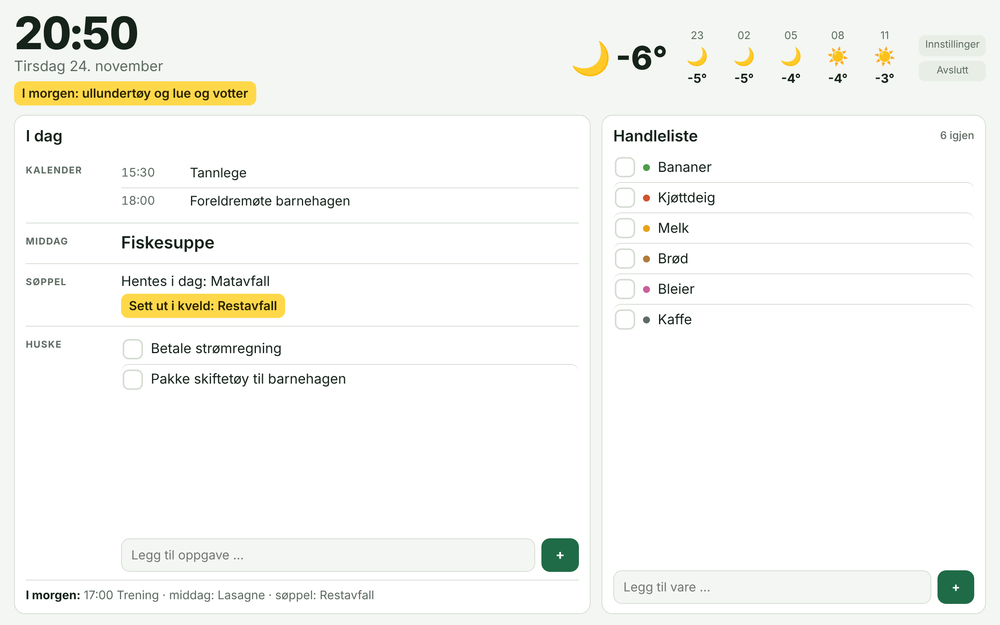

# Kjøleskapsskjerm

En felles skjerm på kjøleskapet som viser det som gjelder **i dag**: klokke, vær, hva barna må ha på seg, dagens avtaler, dagens middag, søppeltømming, huskeliste og handleliste.

## Dagens løsning (fra 24. november 2026)

Skjermen er **Handlelista**, appen vi allerede bruker på telefonene. Den ligger som en artifact på claude.ai og har nå en egen **kjøleskapsmodus**. Alt dere gjør på telefonen, dukker opp på skjermen med en gang, og omvendt.

> Nettsiden i dette repoet (`index.html`, GitHub Pages) var første versjon. Den virker fortsatt, men den er ikke koblet til Handlelista og brukes bare som reserve.

### Slik ser «I dag»-visningen ut

| Del | Hva den viser | Hvor dataene kommer fra |
|---|---|---|
| Øverst | Klokke, dato, vær nå og de neste timene | Værdata som Claude legger inn hver morgen (se under) |
| «Ta med i dag» | F.eks. «regntøy og støvler» eller «ullundertøy, lue og votter». Etter kl. 17 gjelder den i morgen | Regnes ut fra været mellom 07 og 17 |
| Kalender | Dagens avtaler | Google Kalender, via Google Kalender-koblingen i Claude |
| Middag | Dagens middag | Ukemenyen i Handlelista |
| Søppel | «Hentes i dag» og «Sett ut i kveld» (fra kl. 12 dagen før) | Faste tømmeregler fra BIR (se under) |
| Huske | Felles huskeliste. Kryss av når noe er gjort | Handlelista (synkes mellom telefonene) |
| Handleliste | Det som mangler, sortert etter kategori. Legg til eller kryss av rett på skjermen | Handlelista |
| I morgen | Én linje etter kl. 17 med morgendagens avtaler, middag og søppel | Som over |

Fra kl. 22 til 06 bytter skjermen til mørkt tema.

### Slik åpner du kjøleskapsmodus

1. Åpne Handlelista.
2. Gå til fanen **Lista**, scroll helt ned og trykk **Kjøleskapsmodus**.
3. Enheten husker valget. Trykk **Avslutt** oppe til høyre for å gå tilbake til vanlig visning.

Kjøleskapsmodus gjelder bare enheten du trykker på. Telefonene påvirkes ikke.

## Vær: morgenkjøring

Claude.ai lar ikke Handlelista hente data fra andre nettsider selv. Derfor kjører en **planlagt oppgave hver morgen kl. 05:27**. Den henter timevarselet for Nesttun fra yr.no og legger det inn i Handlelista. Varselet dekker resten av dagen og hele neste dag.

- Hver kjøring dukker opp som en egen liten tråd i Claude-prosjektet. Det er normalt.
- Feiler en kjøring, viser skjermen været fra dagen før til neste kjøring går bra.
- Den planlagte oppgaven heter «Vær til kjøleskapsskjermen» og kan slås av i listen over planlagte oppgaver.

## Kalender: Google Kalender-koblingen

Kalenderen hentes med **Google Kalender-koblingen (connector) i Claude**, med kontoen som er logget inn på claude.ai. Den oppdateres hvert 5. minutt.

- Første gang kjøleskapsmodus åpnes, spør Claude om siden får lese Google Kalender. Trykk **Tillat**.
- Hvilke kalendere som vises, velger du under **Innstillinger** i kjøleskapsmodus. Skriv kalender-ID-ene skilt med komma. `primary` er din egen hovedkalender. ID-en til den felles kalenderen finner du på PC i Google Kalender: ⋮ ved kalenderen → **Innstillinger og deling** → **Integrer kalender** → **Kalender-ID**.
- Innstillingen lagres bare på enheten du skriver den inn på. Den må altså også legges inn på nettbrettet.

## Søppel: BIR

Tømmedagene ligger som faste regler i Handlelista:

| Type | Når |
|---|---|
| Restavfall | Hver onsdag |
| Matavfall | Annenhver tirsdag |
| Papir og plast | Hver 4. tirsdag |
| Glass og metall | Ikke lagt inn ennå (BIR viser ingen kommende dato) |

Ved jul og andre helligdager kan BIR flytte tømmedager. Sjekk BIR-appen da. Hvis noe endres, eller når neste dato for glass og metall er kjent, ber du Claude oppdatere reglene.

## Nettbrettet

Anbefalt: Samsung Galaxy Tab A9+ (11") eller et lignende Android-nettbrett, en magnetisk holder og en lang USB-C-kabel.

1. Sett opp nettbrettet og koble det til wifi.
2. Slå på batterivern, så det tåler å stå i lading hele tiden: **Innstillinger → Batteri → Batterivern**.
3. Installer **Fully Kiosk Browser** fra Play Butikk.
4. Åpne claude.ai i Fully Kiosk og logg inn med kontoen som eier Handlelista.
5. Sett **Start URL** til lenken til Handlelista, og slå på *Keep Screen On*, *Fullscreen Mode* og *Start on Boot*.
6. Åpne kjøleskapsmodus (se over), trykk **Tillat** for Google Kalender og legg inn kalender-ID-ene under **Innstillinger**.

Godt å vite:
- Nettbrettet er logget inn på Claude-kontoen. Fully Kiosk låser det til Handlelista, så chatter og annet er ikke tilgjengelig fra kjøleskapet.
- Innloggingen kan av og til gå ut. Da logger du bare inn på nytt.

## Personvern

- Repoet er offentlig, men inneholder ingen personlige data, adresser, nøkler eller lenker til Handlelista.
- Handlelista er privat på claude.ai. Kalenderen leses med koblingen til den som er logget inn, og lagres ikke i Handlelista.

## Filer i repoet

- `index.html`: den første skjermen (GitHub Pages), nå reserve.
- `apps-script/Code.gs`: kalenderskript for GitHub-skjermen. Trengs ikke for Handlelista.
- `forhandsvisning.png`: skjermbilde av GitHub-skjermen.
